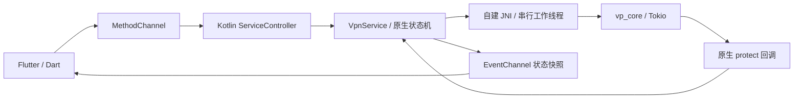
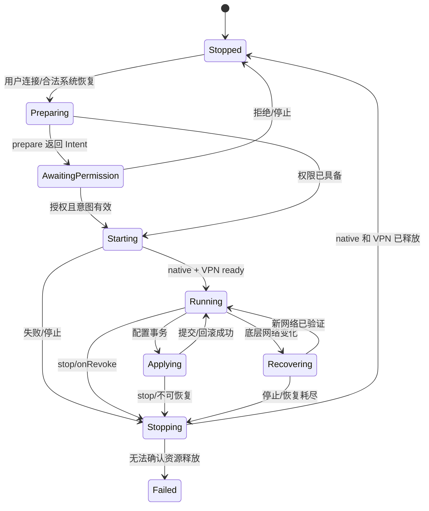

# Android 内核通信与生命周期

状态：设计约定，尚未实现。首发只实现 Android 与 Windows；本文件不是“vp_core 已有官方 Android SDK”的说明。真实 C ABI 来自 [调研 S6](core-research.md)，平台规则见官方 [VPN 文档](https://developer.android.com/develop/connectivity/vpn)。

## 1. 核心决策：原生服务拥有内核

采用 **Flutter/Dart → MethodChannel/EventChannel → Kotlin VpnService → 自建 JNI → libvpcore.so**。网络服务必须能在 Activity 销毁、Flutter engine 不存在时独立运行；不把内核生命周期绑在页面、Dart isolate 或 Flutter 插件实例的存活上。

v1 可先采用同应用进程的服务，降低 Binder、FD 和跨进程数据库复杂度。Rust native crash 会杀掉整个进程，这是当前隔离边界；不能承诺 native crash 后 Flutter 仍存活。若改为 `:core` 独立进程，须重新设计 AIDL/Binder、ParcelFileDescriptor、死亡通知和存储所有权，不能通过 Intent 传一个整数 FD。

普通代理可复用原生核心控制器但不调用 Builder；VPN 模式只能由 VpnService 拥有。两个服务实例不能分别创建同一进程中的 vp_core 单例。

## 2. 共享业务接口与 Android 映射（设计接口）

共享 CoreBridge 语义与 Windows 一致，Android 在 platform adapter 中增加 `prepareVpn` 与设备能力。MethodChannel 命令包含 requestId、generation、expectedAppliedRevision、operation、snapshotRevision/hash；大配置通过私有快照文件定位，不通过平台通道反复传整份 YAML。

| Dart 业务操作 | 原生责任 |
| --- | --- |
| capabilities | 回传 coreBuildId、ABI、targetSdk、protect/FD/DNS 支持、可用规则、reload 分类 |
| prepareVpn | Activity 负责用户授权结果，原生记录请求代际，不在后台偷偷弹授权 |
| start / stop | 提交 desiredState，服务串行执行，最终由真实资源状态回执 |
| applySnapshot | 校验 hash/根目录/权限，根据变更 reload 或 VPN rebuild |
| select / stats / connections | native host 封装已验证 API；状态与累计流量可用 C ABI 查询 |
| events | 服务发布 StateFlow 快照、序号和 generation；UI 重连先全量 queryStatus |

错误至少包含 `VPN_PERMISSION_REQUIRED`、`VPN_REVOKED`、`FGS_START_REJECTED`、`TUN_ESTABLISH_FAILED`、`FD_HANDOFF_FAILED`、`SOCKET_PROTECT_FAILED`、`DNS_NOT_READY`、`CORE_START_FAILED`、`CONFIG_REJECTED`、`ROLLBACK_FAILED`。统一 code 是设计约定，不是上游错误常量。

MethodChannel 只承载 UI 到原生控制命令；protect 回调必须由 Rust/JNI 直接调用原生服务，不能绕 Dart、等待页面或依赖主线程消息循环。

## 3. 真实上游 C ABI

| 函数 | 实际语义与注意事项 |
| --- | --- |
| `int vp_init_logger(const char*)` | 进程内 Once 初始化；重复调用不改变已安装 subscriber，不是动态日志级别 API |
| `char* vp_validate_config(const char*)` | NULL 表示通过，非空错误字符串须 vp_free_string；只执行 parse_and_validate |
| `int vp_start(const char*, int tun_fd)` | UTF-8 YAML/JSON；fd≥0 注入 TUN，fd<0 不注入；同步阻塞装配；0 不保证必需 TUN/listener 已成功 |
| `int vp_stop(void)` | 取走全局实例，runtime shutdown_timeout 600ms；无完整 FD/任务/路由释放回执 |
| `int vp_reload(const char*)` | 同步调用 reload_with_text，使用启动时 Format/base_dir；不能据此重建 Builder 或更换 FD |
| `int vp_is_running(void)` | 仅检查全局实例存在，不代表 VPN、网络或数据面健康 |
| `void vp_get_stats(uint64_t*, uint64_t*)` | 累计上传/下载；未运行返回 0，跨代需重设速率基线 |
| `char* vp_last_error(void)` | 全局错误槽的分配副本，可能被下一次调用清除/覆盖 |
| `char* vp_version(void)` | 分配的版本字符串，调用方释放 |
| `void vp_free_string(char*)` | 只用于上游返回的堆字符串；NULL 安全 |

原始状态码：0 成功，-1 已运行，-2 参数无效，-3 配置/装配失败，-4 runtime 创建失败，-5 未运行。JNI 在同一串行工作线程调用命令并立即读取 last_error，复制为 JVM 字符串后释放；不得将错误指针保留给下次调用，也不得用 libc free 释放。

所有 FFI 调用放专用 executor/coroutine dispatcher，避免主线程 ANR；上游持全局锁运行 start/reload/stop，不能假设 stats 一定瞬时返回。生命周期命令不得并发进入库，JNI 回调不可重入同一组 FFI 锁。`vp_start` 当前没有取消接口，stop 意图到来时先标记过期，待启动返回后立即清理，生产建议补充可取消启动。

输入使用真实 UTF-8 C 字节缓冲和 NUL 结尾，拒绝文本中的嵌入 NUL。JNI 的 Modified UTF-8 与普通 UTF-8 不等价，不直接用 GetStringUTFChars 对任意非 BMP 文本冒充配置 UTF-8；建议传 UTF-8 ByteArray 或正确转码。返回字符串也需正确转为 JVM 字符串。

上游没有现成 `Java_...` 导出、JNI_OnLoad、socket protect、日志订阅、UID/package、networkChanged 或 dataRoot 参数。JNI 封装和这些宿主能力必须自行实现。

## 4. Manifest 与 Android 平台条件

1. 服务继承 android.net.VpnService，声明 `android.permission.BIND_VPN_SERVICE` 和 `android.net.VpnService` intent-filter；app 的 VPN 控制入口通过内部 Binder/显式 Intent 管理，不暴露无认证的控制 API。
2. 声明 INTERNET、ACCESS_NETWORK_STATE、FOREGROUND_SERVICE；按真实使用类型声明 Android 14+ 对应 FGS 权限和类型。通知权限、通知渠道、停止动作和设置跳转需按系统版本处理；用户拒绝 POST_NOTIFICATIONS 不等于授予后台随意启动能力。
3. Android 14+ 官方列出已配置 VPN 可满足 systemExempted 的适用条件（含 FOREGROUND_SERVICE_SYSTEM_EXEMPTED）；FlClash 的 specialUse 是另一种声明，需配权限、用途说明及发行渠道要求。**不照抄 specialUse、不无条件声明 systemExempted**，实现时按 targetSdk 和系统对 VPN 的识别条件选择，并验证首次授权启动及 always-on 启动。
4. 从用户可见操作启动 startForegroundService，服务在系统时限内尽快 startForeground，必须先满足前台服务条件，再做耗时配置/核心启动；后台启动受系统限制，失败结构化返回。
5. `VpnService.prepare(context)` 非空时由 Activity 走授权流程；返回成功后重新核对 intent revision。用户在等待授权时按停止，则迟到的授权结果不能再启动。
6. always-on / lockdown 只在完成无 Flutter 冷启动、快照恢复、撤权和系统重启验收后启用。在此之前显式声明不支持 always-on，并隐藏对应产品承诺。

最小 SDK/targetSdk 作为构建决策记录，不从 `libvpcore.so` 文件名推断。建议优先 arm64-v8a 真机与 x86_64 模拟器；armeabi-v7a 只有完整链路测试后才发行。

## 5. VPN 启动顺序

1. 用户连接意图进入原生仲裁器；读取私有有效 snapshot、能力、凭据与资源，不要求 Dart 在线。
2. 完成 VPN prepare；明确拒绝、撤销、无 Activity 和待用户操作状态。
3. 启动前台服务与通知，注册非 VPN 底层网络观察；检查 desiredState/generation。
4. 初始化 JNI 和日志，注册**原生** socket protect、底层网络与必要 DNS 回调；此时还没有捕获默认流量。
5. 使用不改变系统网络的严格 preflight：校验配置、资源、规则、必需节点、运行目录。普通 vp_validate_config 不足以完成这一步。
6. 配置 Builder 的 address、route、DNS、MTU、按应用策略、会话名；调用 establish，null 或异常都算启动失败。
7. 将 FD 按明确所有权契约交给 native；启动内核，等待 TUN 数据面、DNS、必需 listener 和 protect 路径的结构化 ready。
8. 验证 VPN 内 DNS 和 TCP/UDP 数据面，提交 appliedRevision；更新前台通知与 UI Running。失败立即释放 VPN，不能保留系统已接管但无人读包的接口。

Android Builder 建立接口时即可能切换系统路由，不存在天然“数据面 ready 后才自动路由”的两阶段提交。严格预检和尽快 native ready 可缩小窗口，失败则立即撤销；不要把这个窗口写成零中断保证。

## 6. FD 所有权：必须在修补层确定

当前 `create_tun_device` 使用 `File::from_raw_fd(fd)`，一旦执行便获得关闭责任；但发生错误时可能在消费 FD 前返回，也可能消费后再失败，上层还可能吞掉 TUN 失败而返回 0。因此现有 vp_start 返回码**不足以判断 FD 是否已转移**。

建议新桥接契约（设计接口）：JNI 传入 **borrowed FD**，Rust 入口首先 dup 成 owned FD 并统一 RAII；调用方只在入口返回后关闭自己的描述符。新入口承担所有成功/失败路径中 duplicate 的关闭责任。这样 JVM 的 ParcelFileDescriptor 与 Rust 各拥有一个不同 fd，避免双关、泄漏及 fd 复用误关。

| 阶段 | Java/Kotlin | native |
| --- | --- | --- |
| establish 后 | 独占 ParcelFileDescriptor | 无所有权 |
| borrowed handoff 中 | 保持原 FD 有效 | 入口立即 dup；失败时清理自己的 duplicate |
| handoff 返回 | 关闭原 PFD；不能再用整数操作 native fd | 成功则独占 duplicate；失败全部释放 |
| stop 完成 | 无残余 PFD | 取消包读写、等待任务完成、关闭 owned FD 并回执 |

这是**需要新增的入口契约**，不能把建议 JNI 函数名冒充已有 vp_start。若原型直接调用现有 vp_start，必须跟踪内核修改明确消费边界；不能简单在异常分支 close(detachFd) 而冒险关闭已经转移或复用的 FD。

S10 当前使用 tokio::fs 包装 FD。Builder 默认非阻塞，而 tokio::fs 不等于专门的异步 TUN 包设备；直接复制 FlClash 的 `setBlocking(false)` 可能得到 EAGAIN/错误轮询。生产选用 native AsyncFd 或可取消阻塞读取的专用实现，验证每次读写 IP 包边界、短写、停止时唤醒和无任务残留；不能仅改 setBlocking(true) 就宣布解决。

## 7. socket protect 与底层网络：Android 发布阻塞项

注册 `protect(fd) → Boolean` 回调后，每一个内核自建外连 socket 必须在 connect/首次发包前调用，并检查成功；失败停止该连接并上报原因，不递归经 VPN 重试。

覆盖范围必须包含：DIRECT TCP/UDP、代理节点 TCP/TLS、Hysteria/TUIC/QUIC endpoint、WireGuard、SS UDP、DNS UDP/TCP/DoT/DoH、ECH bootstrap、测速、健康检查、订阅下载（若仍由 native 发起）和所有重连路径。只修复 vp_transport::dial_tcp_multi 远远不够，协议内还直接创建 UDP/QUIC socket。

Rust/Tokio 工作线程回调 JVM 时，JNI 保存 JavaVM 与 service 的受控 GlobalRef，按需 attach 当前线程，处理 Java exception、返回失败和服务代际；停止时先停止新回调，排空在途调用，再释放引用。禁止把某个线程的 JNIEnv 缓存给其他线程。

`setUnderlyingNetworks` 是系统对底层网络的声明，不代替每 socket 的 protect 或绑定；`bindProcessToNetwork` 会影响全进程，也不能作为默认替代方案。底层 Network 可配合 `Network.bindSocket` 在合适顺序绑定具体 socket，必须验证协议库创建 endpoint 的方式。

临时把自身 package 排除出 VPN 只能作为诊断性实验：它影响应用自身下载、测试与 lockdown 语义，不能代替完整 protect，也不能与“本应用流量必经 VPN”的功能承诺同时成立。

## 8. DNS、FakeIP、地址族与 Builder

运行配置必须显式 `tun.enable: true`、`tun.auto-route: false`；FD 仅通过 native 参数传递，不能写入可持久化 YAML。地址、MTU、FakeIP 范围由 DeviceSettings 与共享编译结果联合生成，Builder 与 native 使用同一值。

当前上游 TUN 启动另开 `0.0.0.0:53` DNS listener，失败只 warn；Android 普通应用不能依赖成功绑定受限 53 端口，更不应把它暴露在所有网卡。TUN 内部的 UDP 53 劫持又使用独立 FakeIP 池和系统 resolver，与配置 DNS 路径不一致，必须合并。

生产建议将 Builder 的 DNS 指向 VPN 内的虚拟 DNS 地址，由 TUN 包层直接拦截并交给共享 resolver + FakeIP pool，不开物理网卡 53 监听；处理 UDP 53，同时明确 TCP 53 和系统 Private DNS 的行为。bootstrap resolver 必须能通过已 protect 的底层 socket 访问，避免系统 DNS 再进入 VPN 的递归。

IPv4 首发也需要定义 IPv6 处置：未支持时验证 Android 对未配置地址族的阻断行为，不调用 allowFamily(AF_INET6) 放行，不使用 allowBypass；不能仅设置 vp_core `ipv6:false` 就声称防绕过。提供 IPv6 模式前必须验证 addAddress/addRoute、AAAA、FakeIP/真实地址、UDP、代理协议端点及无旁路流量。

按应用 VPN 的 allow/disallow 两种名单互斥；包不存在、卸载、工作资料和多用户分别诊断。名单由本机设置保存，变更需重新 establish；不要为绕过 protect 缺失而偷偷把自身加入排除名单。

## 9. 状态机、恢复和 UI 重连

原生保存 desiredState 和 intentRevision，StateFlow 显示实际状态。Activity 重建不重新 start；绑定后查询完整状态，再订阅事件。连接按钮、通知停止、快捷磁贴、权限结果、always-on 请求全部进入同一个仲裁器。

`onRevoke` 立即使旧连接意图失效，停止并释放 VPN，不自动循环拉起权限页。`onDestroy` 只做最后兜底，正常关闭必须显式 stop；系统杀进程不会保证调用 onDestroy。进程死后旧 FD 已失效，恢复只能重新 establish，不能从磁盘读出上次 FD 整数复用。

`onStartCommand(null)`、系统 always-on 冷启动、Flutter 不在时的初始化必须有明确行为。首发未完成 always-on 时不靠 START_STICKY 承诺保活；force-stop 后通常需要用户重新启动，不能写“自动保证恢复”。lockdown 的断网行为由系统策略控制，不能试图用失败直连规避。

## 10. 网络切换、重载与停止

观察具有 INTERNET + NOT_VPN 的网络及 LinkProperties，不能仅跟随“默认网络”而选回自己的 VPN。网络变化采用约 300–1000ms 去抖；使用最新有效网络，更新 underlying network、bootstrap DNS 和外连 socket 绑定。

当前无 networkChanged/resetNetwork API，已有 QUIC/UDP 会话也不保证自动迁移。v1 用受控 core restart 或 VPN rebuild 恢复新网络，标记可能断开连接；待补齐连接池失效、DNS 刷新和底层 socket 工厂后再实现更平滑切换。无网络显示 waitingNetwork，不进行无界 CPU 自旋或每秒弹错。

规则/节点热更新仍保持 `tun.enable=true`、同一 FD、同一 Builder 参数。注意 S6 初次 tun_fd 注入只改内存 cfg，原始 config_meta.text 未必包含 tun 段；后续文本若遗漏 tun，sync_tun_state 可能关闭 TUN。生成器必须保留显式 tun 配置，且 native reload 不得重新消费旧 FD。改变 MTU、地址、FakeIP、DNS、IPv6、应用名单时按保守策略重建 VPN。

停止顺序：更新 stop 意图 → 停止新配置/网络恢复任务 → native 停止接入与外连 → 取消并等待 TUN/DNS/健康任务 → 关闭 native FD → 确认无活动 VPN 资源 → 注销 network callback / 释放 JNI 引用 → stopForeground / stopSelf → 发布 Stopped。异常导致无法确认 FD 释放时，不在同一实例上启动新 VPN；必要时终止独立 core 进程（若已采用隔离方案）并明确报告失败。

停止不能在主线程阻塞；设计预算可与 Windows 对齐，启动 15 秒、普通命令 5 秒、停止 5 秒。上游 runtime 的 600ms timeout 不构成包 I/O 已全部退出的证据。

## 11. 构建、存储与日志

- 通过 `jniLibs/<abi>/libvpcore.so` 打包正确 ABI；自建 JNI 库另行链接 C ABI。固定 Rust/NDK/AGP、补丁和库摘要，不能只替换 so 而不更新能力清单。
- Android 16 KB 页设备需检查 ELF LOAD 对齐、ZIP 对齐和所有第三方 so，按 [官方页大小说明](https://developer.android.com/guide/practices/page-sizes) 真机/模拟器验证；上游 cargo-ndk 默认流程不足以证明合规。
- FFI 依赖 cwd，Android cwd 不能被当作 filesDir。v1 本地 provider 用绝对路径；完整 Geo 接入需要新增显式 dataRoot，禁止在共享进程通过 chdir 改全局目录。
- 私有运行快照排除系统 Auto Backup 中的 token、临时文件和设备状态；凭据使用 Android Keystore 管理的密钥加密。锁屏前后、首次解锁前的 always-on 读取策略需单独设计。
- 当前 logger 不是 Android logcat 订阅 SDK。JNI/Rust 添加受限的 tracing sink 或宿主日志环形缓冲；日志脱敏、限量、按页面订阅，不能把 native stdout 默认视为可靠可读通道。

## 12. 发布验收矩阵

| 类别 | 必须通过 |
| --- | --- |
| 系统 | 最低支持 API、Android 13 通知、Android 14+ FGS、目标 SDK 对应最新系统；至少 Pixel 与一种主流厂商真机 |
| ABI | arm64 真机、x86_64 模拟器、16 KB 页；若发行 armv7 则另测 |
| 权限 | 首次授权、拒绝、等待时停止、授权后立即撤销、其他 VPN 替换、后台启动被拒 |
| 数据面 | DNS UDP/TCP、A/AAAA、FakeIP、一条 TCP/一种 UDP/QUIC 出站、DIRECT、测速；验证 protect 调用成功与无回环 |
| FD | establish 失败、dup 失败、接管前/后启动失败、stop 超时、连续 100 次启停，无 fd/线程增长或误关复用 fd |
| 生命周期 | 页面销毁/旋转、Flutter engine 重建、通知停止、进程强杀、系统服务重建、force-stop、合法 always-on 冷启动 |
| 网络 | Wi-Fi ↔ 蜂窝、飞行模式、DNS 变化、无网络、休眠/Doze、IPv6-only/NAT64（若承诺支持） |
| 配置 | start/apply/stop 交错，坏 provider、缺 Geo、监听失败、TUN 失败不得显示 Running，回滚到已验证快照 |
| 长稳 | 24 小时、网络和节点多次切换；监控 wakelock、CPU、电量、RSS、FD、后台任务数量 |

这些 Android 真机与打包测试尚未执行。当前完成的是源码调研和宿主侧可执行测试，见 [验证记录](verification.md)。
