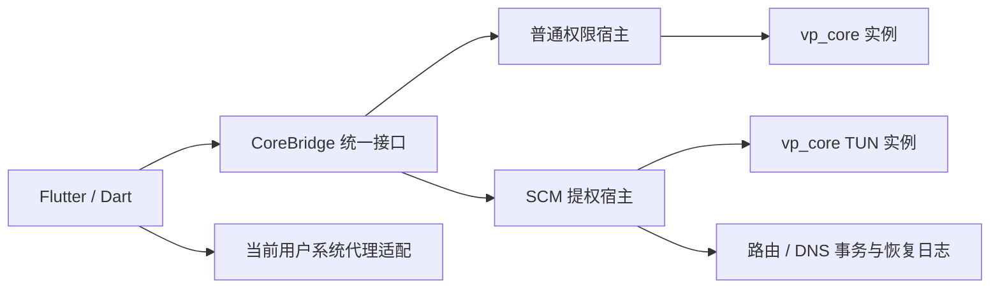
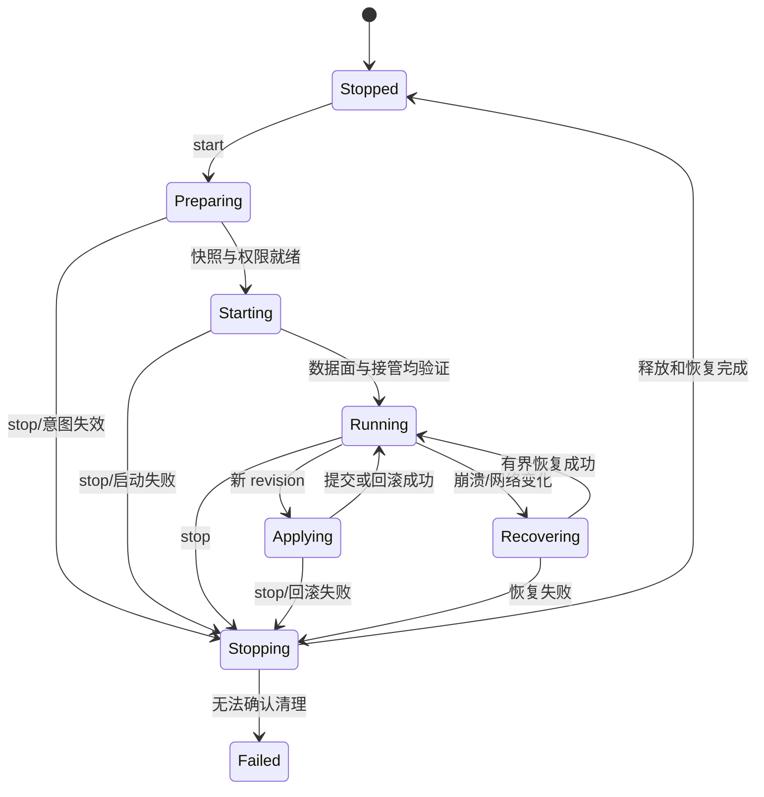

# Windows 内核通信与生命周期

状态：普通代理宿主及当前用户 WinINet 系统代理已实现，其余提权/TUN/路由与高级控制部分仍为设计。上游事实对应 [调研 S4–S14](core-research.md)；共享配置和规则以 [configuration](configuration.md)、[rules](rules.md) 为准。

## 1. 架构选择

Windows 首发定位 x64；最低 Windows 版本需由 Flutter、Wintun、宿主及安装器联合测试后确定。开发矩阵至少 Windows 10 22H2、Windows 11 当前受支持版本；ARM64 另行构建和验证，不用 x64 包宣称原生支持。

采用 **Flutter UI + 独立原生 CoreHost + vp_core**。CoreHost 负责唯一运行实例、配置应用、日志与系统恢复；普通代理可由普通权限宿主启动，TUN 由受限的提权服务管理。Dart 不直接加载 DLL 操作系统路由，也不让整个 Flutter UI 长期以管理员运行。



P 与 S 是两种所有权模式，**同时只能有一个活动内核**。从普通模式切到服务模式走迁移事务：停止旧实例并确认释放端口，再由服务启动目标快照。关闭窗口、退出 UI、停止代理是不同动作，必须分别定义。

原型可先直接运行上游 `vpcore.exe` 验证非 TUN 通信；生产 CoreHost 建议链接 Rust `vp-app` 或托管修补后的 CLI。生产方案需要的 ready/hash、严格启动、定向清理不属于现有上游接口。

## 2. 共享 CoreBridge 语义（设计接口）

两端均暴露异步 `capabilities`、`start`、`stop`、`applySnapshot`、`select`、`queryStatus`、`queryStats`、`queryConnections` 和事件订阅；Windows transport 负责把它们映射到宿主 IPC 和已验证 REST。

```json
{
  "requestId": "uuid",
  "generation": 12,
  "expectedAppliedRevision": 41,
  "operation": "applySnapshot",
  "snapshotRevision": 42,
  "snapshotHash": "sha256:..."
}
```

响应包括 requestId、generation、ok、实际 appliedRevision/hash、结构化 error；错误字段至少 code、stage、retryable、rollbackStatus、脱敏 message。`timeout` 只表示未收到结果，必须 queryStatus 对账，不能盲目重试一次启动。

CapabilityManifest 包含 coreBuildId（commit + patchset + artifact hash）、hostProtocolVersion、可用规则/协议/接管方式、reload 分类、标准 WS、严格资源校验等。`GET /version` 的版本字符串不能替代能力清单。

事件以 generation + sequence 排序；过期连接返回的数据不覆盖新会话。命令队列串行执行，stop 可以更新 desiredState 使尚未提交的 start/apply 失效。

## 3. 当前上游 CLI 契约

真实命令示例，绝对路径通过参数数组传入，不经过 shell 拼接：

```text
vpcore.exe validate -c <absolute-config.yaml> -d <absolute-resource-root>
vpcore.exe run -c <absolute-config.yaml> -d <absolute-resource-root> --managed-stdin --log-level info
```

`validate` 的 `-d` 参数当前被忽略，只解析文本和有限静态校验。`run` 的 `-d/-D/--directory` 初次装配可指定资源根，但基于文件的后续 reload 有路径重新取 parent 的行为。因此把 config 和其资源快照置于同一 revision 根，并使用绝对 provider 路径；不要依赖初次 `-d` 永久沿用。

`--managed-stdin` 下写 `stop\n` 并 flush，或关闭 stdin，内核退出循环。stdout/stderr 必须从启动起持续异步读取，避免管道填满导致假死；UTF-8 分段解码，不能假定一块输出就是完整日志行。

**不可直接用于生产的退出行为**：当前 CLI 无论是否启用 TUN，正常退出都会调用 `clean_all_routes()`，可按网段删除双 `/1` 路由。不要在用户现有 VPN/路由环境中把它当无副作用的普通 stop；生产须改用不走此路径的 CoreHost，或修补为只清理本实例拥有的路由。本文不会执行 `run`、`clean-routes` 或改动系统路由来验证文档。

当前 CLI 每秒监控启动配置 mtime，配置应用不能同时依赖 watcher 和 REST。启动文件不可变，新 revision 另存路径，通过显式 apply 入口切换；生产宿主移除隐式 watcher。

## 4. 当前 REST API 精确映射

控制器配置 `external-controller: 127.0.0.1:<port>`、随机非空 `secret`；每请求使用 `Authorization: Bearer <secret>`。只监听 loopback，不生成 0.0.0.0 控制器。订阅不能决定地址、secret 或本地文件路径。

| 操作 | 当前接口 | 约束 / 适配 |
| --- | --- | --- |
| 版本探测 | `GET /version` | 返回 meta、version、premium；不是完整 ready |
| 获取组/成员 | `GET /proxies`、`GET /proxies/{group}` | 单节点不保证可通过详情接口查询，列表主要从组成员衍生 |
| 手选成员 | `PUT /proxies/{group}`，JSON `{"name":"<member>"}` | 成功 204；使用稳定 ASCII 内核名，验证组类型与成员 |
| 测速 | `GET /proxies/{group}/delay?member=<member>&url=<url>` | 测的是组成员；当前 url 参数被回显但没有传到 url_test_member，不能承诺可任意指定测试 URL |
| 规则列表 | `GET /rules` | 解析展示不完整；不作为源模型或无损导出 |
| 当前模式 | `GET /configs` | mode 是 Debug 大小写如 Rule/Global/Direct；适配层规范化；不返回完整配置 |
| 重载 | `PUT /configs`，JSON `{"path":"<absolute-path>"}` | 204/500；没有 `{payload: ...}` 文本加载协议；不能用 PATCH 切 mode |
| 连接快照/累计流量 | `GET /connections` | 包含 connections、uploadTotal、downloadTotal；大列表需要采样频率与上限 |
| 断连接 | `DELETE /connections/{id}` / `DELETE /connections` | 存在相应实现；204 时不依赖响应体 |
| provider 展示/刷新 | `GET /providers/proxies`、`GET/PUT /providers/proxies/{name}` | 刷新会重装配置，不保证只刷新指定 provider；updatedAt 是生成响应时间，不能当真实订阅更新时间 |
| DNS flush | `POST/PUT /dns/flush` | 当前只回成功消息，未清缓存；UI 不应显示真实清缓存成功 |
| 流量推送 | `GET /traffic` | 固定 Sec-WebSocket-Accept: vpcore，标准 Dart WebSocket 会校验失败，v1 禁用 |
| 日志 / memory / 规则 provider / 退出 | 无对应已实现接口 | 日志来自宿主管道；停止走生命周期入口；其余需扩展 |

HTTP 服务每连接处理一个请求后关闭；宿主必须容忍短连接。请求头上限 64 KiB；body 当前最多读取 1 MiB，超大并非可靠的 413 语义。大配置使用受控本地文件路径，不把整份配置塞 REST body。设置读写与总超时、限制并发，不依赖 chunked 请求上传。

`PUT /configs` 接受内核进程可读的路径；普通 UI 不能直接把任意路径作为提权服务命令。服务只接受 snapshot ID/hash，从自己的受控根定位文件并核验内容。

轮询方案：前台流量每秒读取 `/connections` 的累计值，速率用单调时钟计算 `deltaBytes/deltaSeconds`；连接列表面板关闭时降低频率，后台降至 5–10 秒或按需。计数减少或 generation 改变时重置基线，首个样本不显示成“瞬时峰值”；平台/内核统计不承诺等于物理网卡流量。

## 5. Windows IPC、权限与安装

普通权限宿主可用受限 Named Pipe；SCM 服务使用不同的受控 pipe，明确 DACL 限制为安装所有者 SID 和必要系统主体，拒绝远程客户端，并核验连接端实际身份。pipe 名或 PID 字符串不构成认证；参照 [Named Pipe 官方说明](https://learn.microsoft.com/en-us/windows/win32/ipc/named-pipe-security-and-access-rights)。

提权服务（设计名 `FLVPcoreCoreHost`）仅允许固定操作：query、startSnapshot、applySnapshot、stop、recoverOwnedNetwork。不可开放“运行任意 exe/命令/路径”、上传 DLL 或修改任意注册表项。服务绑定签名/校验通过的安装内核和 Wintun，核验快照文件、目录 ACL 与 reparse points，避免用户可写目录替换二进制或配置中的敏感路径。

服务安装/升级时经 UAC 提权一次；普通启动不重复弹 UAC。拒绝安装或权限不足可回普通代理模式，并给出当前 TUN 不可用的原因；不把拒绝权限当内核崩溃循环重试。

子进程由宿主保留进程句柄、创建时间和 generation，使用 Job Object 管理本实例进程树；KILL_ON_JOB_CLOSE 仅用于宿主确实终止的最终兜底，不替代优雅关闭与网络恢复。服务托管时 UI 不持有可因关窗口就误杀进程的 job 所有权。

Wintun 与宿主架构匹配，放在只读安装目录；固定绝对加载路径和摘要。当前上游会探测环境变量、cwd、TEMP 等位置，提权宿主必须收窄加载来源，不能沿用宽泛搜索。安装器同时携带许可、驱动来源、校验和与卸载恢复逻辑。

## 6. 系统代理与 TUN 是两种接管方式

2026-10-30 实现：`native/core-host/src/system_proxy.rs` 使用 `InternetQueryOptionW` / `InternetSetOptionW(INTERNET_OPTION_PER_CONNECTION_OPTION)`，读取 LAN 的 `FLAGS_UI`（含 PAC/WPAD）、手动代理地址、绕过与 PAC URL；设置 `DIRECT | PROXY`，禁用 PAC/自动发现并指向本实例 mixed 端口。写后发送刷新通知并读回核对。这里保存的是 WinINet 有效设置语义，不承诺恢复注册表键的原始字节布局或“不存在/空字符串”差别。没有修改 WinHTTP、RAS 连接、其他用户、路由或 DNS。

恢复日志 `state/system-proxy.json`（schema 2）含原设置、写入设置、事务标识及 Windows 用户 SID，先 flush/sync 后发布再写 WinINet；它可能含用户原 PAC URL，应视为私有状态文件，不写入诊断日志。每个应用数据目录用 OS 文件锁 `state/network.lock` 限制一个宿主拥有恢复权；第二个实例拒绝写操作。正式入口使用同一个 path_provider 数据根，不支持通过多个自定义数据目录同时接管同一用户。

桥接 v1 通过 capability `systemProxy` 协商新增 `enableSystemProxy` / `disableSystemProxy` 操作，沿用 generation/revision 校验；成功变更提升 generation。状态新增 `systemProxy`（实际设置仍匹配本实例）及 `systemProxyRecoveryError`。无数据目录或锁不可用时能力为 false。UI 只在内核已启动时允许开启，以成功回执更新；该开关表示当前接管状态，不持久化为自动连接偏好。

运行中 apply 先恢复原设置，再关闭旧 listener；新 listener 验证后重新接管新端口，失败回滚到旧配置和旧端口。stop/EOF/正常 Drop 先恢复再关闭 listener；Dart 监测宿主退出后启动同一 exe 的 `--recover-system-proxy` 恢复入口；下次初始化也自动恢复。若 UI 和宿主同时被杀或断电，只保证下次启动恢复，不宣称存在常驻系统恢复服务。

恢复逐字段只接受原值/本实例写入值（包括中断的部分写入），发现任一外部值则整组保留、显示冲突并保留日志。WinINet 无跨进程 compare-and-swap：读取与写入之间仍有极短竞争窗口；当前不提供强制覆盖/自动抢回功能。发生冲突需用户检查 Windows 代理设置与私有日志，不能用重试开启覆盖外部设置。TUN 仍不可用。

普通代理首先验证 mixed HTTP/SOCKS5 可用，再设置**当前用户**系统代理。通过 WinINet 对应配置 API 修改并广播设置刷新；不能认为改注册表即已通知全部应用，也不能默认修改 WinHTTP 或其他用户设置。不是所有程序都遵循系统代理，这属于模式行为，应在产品内清楚表达。

启用前保存 ProxyEnable、ProxyServer、ProxyOverride、PAC/自动发现等受影响配置的原值、用户 SID、写入值及事务 ID。停机/崩溃时只在当前值仍等于本实例写入值时恢复；若用户或其他代理后来更改，提示冲突并不覆盖。恢复日志必须在写系统设置之前落盘，启动时处理未完成事务。

TUN 默认与系统代理互斥，避免双重转发；若未来允许同时启用，必须作为单独模式测试。TUN 模式要明确是否接管 IPv4、IPv6、DNS、LAN 和应用例外，不可仅将 `tun.enable=true` 等同于全局 VPN。

## 7. Windows 路由与 DNS 事务（需实现）

S11 当前仅添加 TUN 地址所属网段，不建立完整的默认流量接管、节点服务器绕行和底层网卡选择；驱动只提供虚拟网卡，并不自动实现这些策略。

生产设计：`tun.auto-route: false`，由特权宿主独占系统路由/DNS 管理：

1. 记录物理出口、接口 LUID/索引、网关、现有路由与 DNS；区分 IPv4/IPv6 和多网卡。
2. 在接管默认流量前建立代理服务器、bootstrap DNS 等必须直出目标的逃逸路径；节点域名解析多地址和重连时也更新。
3. 完成 Wintun、数据面、DNS 和外连可用性后，才提交捕获路由。优先采用原生 IP Helper API 及受控接口绑定，避免 route.exe 文本解析和语言环境差异。
4. 按明确策略接管默认流量；若采用双 `/1`，也必须同时定义其所有权、IPv6 处置和逃逸机制。实现前不提供可直接运行的盲目加路由命令。
5. 逐条保存本实例新增/修改的完整路由键、原值、接口及 generation；停机按相反顺序恢复，仅删除完全匹配本实例的项。
6. 网卡切换、睡眠恢复、DHCP 网关变化时进入 Recovering，更新逃逸与捕获事务；失败先撤掉黑洞路由，再报告断线。

DNS 不应绑定所有网卡 53 端口；根据产品接管方式使用受控地址/端口和一致的 FakeIP resolver。Windows IPv6 若尚未完整验证，要明确阻止或不提供该接管模式，不能仅设置 `ipv6: false` 就声称不会从系统 IPv6 泄出。

原生宿主需要崩溃后外部恢复主体（服务或下一次启动的恢复器）。RAII 无法保证 TerminateProcess、断电时执行，且上游 App 的循环引用/后台任务不能替代显式 shutdown。服务升级、用户注销、系统关机也要走同一所有权恢复路径。

## 8. 状态机与启动顺序



启动顺序：单实例锁 → 恢复历史网络事务 → 核对二进制/能力 → 准备快照 → 预留端口 → 启动宿主/内核 → 认证探测 → 验证真实代理握手 → 建立系统代理或 TUN 捕获 → ready 回执 → UI Running。

端口预检查存在 TOCTOU；生产宿主应自己 bind 后移交 listener 或支持真实 bound-port 回执。原型选择随机高端口，遇 EADDRINUSE 有界重试，不能因为旧端口已有 `/version` 响应就连接陌生内核。随机每代 token 并核验进程所有权。

建议预算：准备 10 秒（所有资源已本地化）、启动 15 秒、普通控制命令 5 秒、优雅关闭 5 秒、最终终止等待 2 秒；均为可调设计值。任何阶段超时先记录真实状态、执行清理与对账，不直接标记 Stopped。

## 9. 停止、崩溃与升级

1. 停止先提升 intent revision，停止新 apply 和轮询写操作；撤除本实例系统代理/捕获路由，避免内核先死造成黑洞。
2. 发送宿主 shutdown（原型 managed-stdin stop），关闭新建连接入口，按策略排空或断开连接；显式停止后台任务、DNS、TUN，并释放驱动资源。
3. 等待进程退出与端口释放，核验网络恢复。超时只终止本实例进程树；不能按 exe 名批量 taskkill。
4. 自动重启采用 1、2、4 秒退避，60 秒内最多 3 次；停止请求立即取消待重启。认证错误、配置错误、无驱动、无权限不自动无限重试。
5. “窗口关闭至托盘”保持会话；“退出并停止”恢复网络后退出。后台保持运行必须明确授权模式，并让服务而非 UI 拥有会话。
6. 更新先校验新包并保留旧版本；停止并恢复网络、切换安装版本、重启 lastKnownGood。新宿主/内核/配置不兼容则回滚二进制和快照，禁止覆盖正在加载的 DLL。

## 10. 必须完成的系统验收

| 类别 | 验收内容 |
| --- | --- |
| 启停 | 连续 100 次启停、重复 start/stop、start 中 stop、apply 中退出；没有孤儿进程、端口或残留路由 |
| 通信 | token 错误、端口冲突、宿主掉线、延迟/重复回执、旧 generation 事件不污染当前状态 |
| 代理 | 原有 PAC/系统代理保留、用户中途修改、UI 崩溃恢复；HTTP 与 SOCKS5 分别测试 |
| TUN | 节点/DoH/QUIC 逃逸、IPv4/IPv6、DNS/FakeIP、LAN、多网卡、休眠唤醒、Wi-Fi/有线切换 |
| 故障 | TUN 创建失败、DNS 占端口、单个 listener 失败不能显示 Running；数据面故障需从 Running 撤回 |
| 服务 | 拒绝 UAC、安装失败、不同用户连接、pipe 身份校验、SCM 重启/关机/升级 |
| 恢复 | 宿主强杀后恢复本实例网络项；其他 VPN/自定义 /1 路由不被删除；恢复失败可诊断 |
| 长稳 | 24 小时、至少 100 次配置/节点切换，无后台健康检查任务或句柄持续增长 |

本轮没有执行这些系统接管测试。普通 REST 单测与静态样例结果见 [验证记录](verification.md)。
