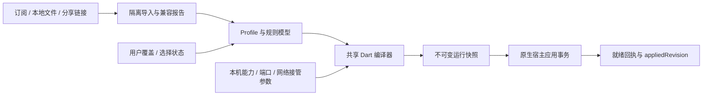

# 全平台一致的配置文件管理

状态：FLVPcore v1 设计约定；对应内核固定基线与 S1–S16 证据见 [调研](core-research.md)。Windows、Android 共用业务模型、编译顺序和迁移代码；平台只提供能力与本机参数。

## 1. 总体决策

采用 **原始输入 → 统一业务模型 → 确定性编译 → 平台运行快照**。不能让每个页面直接修改运行 YAML，也不能让订阅服务器决定控制器、TUN、系统代理、日志路径和本机端口。



一致性指“相同规则含义、数据版本和错误行为”。绝对路径、端口、FD、Windows 路由、Android 包名单属于设备差异，不要求两个系统生成字节相同的最终运行文件。

## 2. 数据分层与所有权

| 数据 | 所有者 / 存储 | 跨端导出 |
| --- | --- | --- |
| `AppSettings` | Dart repository；主题、语言、显示偏好 | 可选 |
| `Profile` | Dart repository；稳定 UUID、来源、业务内容、版本 | 是 |
| `SourceSnapshot` | 原始字节不可变文件 + SHA-256，关联订阅版本 | 可选，含敏感信息时需显式选择 |
| `ProfileModel` | 节点、组、DNS、规则 AST、provider 引用；结构化 JSON/SQLite | 是，按 schema 迁移 |
| `UserOverrides` | 按 profileId 单独保存；用户规则/节点覆盖 | 是 |
| `SelectionState` | groupId → nodeId；不以名称或数组下标作主键 | 是，失效引用必须报告 |
| `DeviceSettings` | 本机端口、接管方式、权限、包名筛选、路径 | 默认否；导入时重新映射 |
| `CredentialStore` | 订阅认证、节点凭据、私钥；平台安全存储/加密库 | 默认否；加密导出需单独选择 |
| `ResourceSnapshot` | 规则集、Geo、ASN 的内容摘要和不可变文件 | 是，可只导出清单；离线包则包含文件 |
| `RuntimeSnapshot` | 宿主独占；本机路径、token、FD 关联、编译结果 | 否 |
| `ApplyJournal` | 宿主独占；pending/applied/lastKnownGood | 否 |

首选共享 Dart 数据层 + SQLite 事务索引，内容大文件落盘。数据库保存元数据、引用和状态，避免在每条规则 UI 更新时整体重写大型 YAML。Android 原生服务读取已提交的运行快照，不在后台重新解释 Dart 数据库；服务状态通过桥接查询。

## 3. 统一交换格式（拟定）

内部文件为 UTF-8 JSON；可读导出支持 vp_core YAML。客户端交换格式名为 `flvp-profile/v1`，**不能直接交给 vp_core**。最小结构示意：

```json
{
  "format": "flvp-profile",
  "schemaVersion": 1,
  "profileId": "8b779d78-5d46-4ac7-a176-a06df0e2fc55",
  "revision": 1,
  "displayName": "示例配置",
  "source": {"kind": "local", "snapshotHash": null},
  "policy": {"mode": "rule", "finalTargetId": "builtin:direct"},
  "nodes": [],
  "groups": [],
  "dns": {"enabled": false},
  "rules": [],
  "providers": [],
  "requiredCapabilities": [],
  "extensions": {}
}
```

这是设计形状，不是已实现 JSON Schema。实现时须提供机器可校验 schema、每个版本迁移器及旧版本 fixture；未知主版本拒绝导入，未知扩展保留但不激活。

1. 节点、组、规则、provider 均有稳定 UUID；引用存 ID，编译时映射到内核名。
2. 节点协议配置按 vp_core 固定版本的 typed schema 表达；不编造通用字段屏蔽各协议差异。凭据字段存 secretRef，运行时再物化。
3. `RuleSpec` 至少包含 id、enabled、predicate AST、targetId、platformScope、origin、order；逻辑规则用树，不能用字符串 split(',') 解析括号。
4. 原始名字仅用于显示。生成内核名字用稳定 ASCII ID（如 `node_<uuid>`、`group_<uuid>`），规避重名、逗号、斜线、保留字与 API 解码问题。
5. 上游名字引用先在单个来源内解析，再转 ID；跨订阅同名节点不合并。订阅更新只有身份可确定时保留原 ID；歧义作为新增/移除报告，禁止仅凭同名挪用选择状态。
6. revision 为本地单调递增整数，不依赖时钟；时间戳使用带时区 ISO 8601，仅用于展示。

## 4. 输入格式与兼容诊断

| 输入 | 处理规则 |
| --- | --- |
| vp_core YAML / JSON / JSON5 | 按真实 schema 导入；保留原始字节；未知字段逐项报告 |
| mihomo / Clash 配置 | 作为兼容导入，不等同于原生；输出字段、规则、协议差异清单 |
| URI / Base64 分享链接列表 | 覆盖已验证协议后启用；逐行报告成功、失败与遗漏 |
| proxy-provider 节点列表 | 作为节点来源，不附带任意全局配置权限 |
| flvp-profile / `.flvp` | 校验 schema、资源摘要、引用，再进行设备能力检查 |
| sing-box、脚本、MRS 等 | v1 不默认转换；保持原始输入并明确“不支持”，不得猜测语义 |

S15 已有订阅解析，但它的“能解析协议”和“该协议所有分享参数均无损保留”不是同一件事。客户端不得采用“丢掉失败行后静默成功”的策略。导入报告应含原始字段路径、原因、处理动作和影响范围。

诊断等级：`error` 阻止应用；`warning` 是可以明确表达且用户可理解的降级；`info` 是别名规范化等无损处理。规则丢失、加密参数丢失、必需 Geo 缺失、目标不存在一律 error。

YAML 用结构化解析器；禁止文本替换节点名、正则覆盖 YAML、执行订阅脚本。重复键、超深嵌套、异常大文档、无法展开的锚点/merge key 拒绝导入。S1 的 YAML 转换不能据此认定支持完整 YAML merge 语义，需有专项 fixture 后启用。

数字在共享层严格检查范围。S2 的部分宽松数字转换使用 `as u16/u32`，客户端必须拒绝溢出而不是让端口 65536 被截断成 0。

## 5. 订阅与资源更新

更新任务统一由客户端控制，Windows 与 Android 使用同一策略模型：

1. 获取任务锁，记录 sourceRevision、ETag、Last-Modified 和请求 ID；按来源指定直连、当前代理或“失败后直连”策略，禁止无提示改变策略。
2. 请求超时建议 30 秒，订阅正文上限 16 MiB；规则/Geo 默认上限 128 MiB，可在实现中按资源类型调小。完整读取并检测超限，不能截断后当合法输入。
3. HTTPS 默认校验证书；重定向跨来源时不转发认证头。URL、认证参数和响应正文不得进入普通日志。
4. 下载到 staging；304 沿用已有快照，200 则计算摘要、解析、严格校验。200 空正文/HTML 错误页不能覆盖旧版本。
5. 生成差异报告；缺节点、缺组成员、未知协议、无效规则等不可静默跳过。应用更新走统一事务。
6. 下载失败保留上一次有效快照，显示过期状态和错误；首次无缓存则失败，不自动换成全直连配置。
7. 一次更新只提交一个完整依赖快照。provider、Geo、ASN、节点数据的 hash 全部固定后才能应用，禁止边启动边异步补齐必需资源。

**设计约定：内核只读取本地资源。** 编译时将 proxy-provider/rule-provider 输出为 `type: file`、绝对 `path`，移除 `url`，显式 `interval: 0`；Geo/ASN 由资源根目录物化，不生成在线 URL。

原因是 S4 的下载会在装配阶段发生，部分定时刷新闭包保留旧规则。客户端和内核同时调度会破坏 revision、缓存和回滚的一致性。节点 provider 可在编译时展开成内联 proxies，或保留本地 provider + `use`，不能直接把 provider 节点名写进配置静态校验不认识的组引用中。

## 6. 确定性编译与覆盖顺序

固定顺序：`来源模型 → profile 用户覆盖 → 用户规则 → 模式编译 → 平台能力检查 → 本机参数注入 → 严格校验 → 序列化`。编译输出带 compilerVersion、coreBuildId、来源版本、资源 hash 和兼容报告。

| 字段类别 | 合并方式 |
| --- | --- |
| 节点、组、provider | 按稳定 ID 操作；新增/替换/删除必须显式；删除前检查引用 |
| rules / sub-rules | 有序操作和 AST；按 [规则规范](rules.md) 排序，不做任意数组拼接 |
| DNS | 显式字段覆盖；nameserver 等列表默认整体替换；清空和未设置分开 |
| scalar | 显式值替换；null 是否表示删除由该字段 schema 定义 |
| 选择状态 | 只作用于仍存在的 select 成员；失效则显示并按约定后备，禁止偷偷改成 DIRECT |
| 本机接管参数 | 由 DeviceSettings/宿主生成，优先级最高，订阅无法覆盖 |
| 不支持扩展 | 保留在原始输入/extensions，默认不生成到运行配置 |

输出固定 kebab-case 内核字段名；object key 稳定排序，业务数组保持语义顺序；统一 LF、UTF-8 无 BOM。数值、bool 不写成字符串。

两种摘要：`logicalHash` 对规范化业务模型、资源摘要、compilerVersion、能力决策取 hash；`runtimeHash` 对实际运行文件和依赖清单取 hash。前者不含路径/端口/token/FD，后者包含实际注入值，不能当公开日志输出内容。摘要不替代凭据加密。

## 7. 运行目录与路径约束

```text
<appData>/
  state/                  # repository、迁移与本机状态
  profiles/<profileId>/    # 模型及来源索引
  objects/<sha256>/        # 已验证内容，不可变
  staging/<transactionId>/ # 未提交内容
  runtime/<revision>/
    config.yaml
    resources/            # file providers / Geo / ASN
    snapshot.json         # revision、hash、依赖、能力与编译版本
  runtime-state/          # journal、applied、last-known-good
  logs/                   # 脱敏、有大小与保留期限制
```

Windows 普通用户数据根可采用 `%LOCALAPPDATA%/FLVPcore`；提权宿主只读取自己受控目录中的核验副本。Android 采用应用私有 `filesDir` 下目录，临时内容使用 `cacheDir`；SAF 导入的外部 URI 先复制到私有 staging，内核不直接读取外部文档 URI。

运行文件中的资源全部是绝对路径；不导出绝对路径。核验 canonical path 落在本事务目录，禁止 `..`、符号链接/Windows reparse point 越界、UNC 或订阅指定的任意本地路径。S4 的 Geo 发现还搜索额外目录，严格模式需要宿主限制为本快照资源根，避免载入机器上无关旧库。

Geo 文件按内核实际识别名物化，如 `geosite.dat`、`geoip.metadb`/`Country.mmdb`、`ASN.mmdb`；内容格式必须验证，不能靠改后缀转换格式。不要在同一快照留下多个会互相抢优先级的 GeoIP 文件。

## 8. 应用事务与回滚

所有 apply、启动、停止、切换 profile、订阅更新使用同一协调器串行仲裁。每条命令携带 `requestId`、`generation`、`expectedAppliedRevision`；后到的停止请求可以使准备中的启动失效，不能让过期回调重新连上代理。

```text
Draft → Staged → Validated → Prepared → Applying → Verified → Committed
                                 ↘ Failed / RollingBack → 原 lastKnownGood
```

1. 在同文件系统 staging 写完并 flush；检查资源完整、引用、能力和 schema。准备阶段不得修改系统网络。
2. 分三层验证：共享模型严格校验；上游 parse_and_validate；宿主装配/规则编译/必需资源校验。动态端口、路由、FD 另在激活时验证。
3. 将 staging 完整目录提交为不可变 revision。用系统原子替换/数据库事务发布指针；跨文件系统移动不算原子提交。
4. 先写 pending journal（旧 revision、新 revision、事务阶段），再按变更分类调用宿主。不能先把 UI activeProfileId 改成新配置并显示已连接。
5. 读取应用回执：实际 revision/hash、必需监听、TUN/DNS、组选择、宿主 generation；代理握手/本地测试通过后才发布 appliedRevision 与 lastKnownGood。
6. 失败时恢复旧 Router 或重启旧快照，并恢复系统代理/路由事务；明确报告 rollback 失败，不伪装为已恢复。
7. 进程重启发现 pending 时先探测实际宿主，不能仅凭文件判断；无法证明新配置已生效则回旧快照。垃圾回收必须跳过 active、pending、lastKnownGood 及被运行宿主占用的资源。

**当前上游限制**：REST 204、vp_reload=0 没有 appliedHash；`GET /configs` 只返回 mode，不能证明完整配置已应用。S4 装配准备会改全局 resolver/tuning，失败保旧 Router 也不等于全状态回滚。生产事务需补齐宿主回执及无副作用准备；原型阶段标记 provisional，必要时重启 lastKnownGood，不能声称具备强事务保证。

**CLI watcher 竞态**：S12 每秒监控启动配置的 mtime。原型必须让启动文件不可变，后续新快照用 `PUT /configs {"path": ...}` 指向新目录，绝不能既覆盖启动文件又发 reload。生产宿主只保留一种显式应用通道；“禁用 watcher”需要自行实现，当前无对应上游 CLI 开关。

## 9. reload 与 restart 分类

| 变更 | v1 默认动作 | 原因 |
| --- | --- | --- |
| select 组成员选择 | 运行态选择 + 持久化 SelectionState | 不必重编译整个配置；重载后重新校验并恢复选择 |
| 规则、子规则、内联节点、组成员 | 有就绪回执和补丁后 reload；否则保守 restart | Router 可替换，选择和后台任务需要重建确认 |
| provider/Geo/ASN 内容 | 新资源快照 + 完整编译，按能力 reload/restart | 不能只替换磁盘文件并期待自动生效 |
| mixed/HTTP/SOCKS 监听、allow-lan、bind-address、controller、secret | restart | 现有监听和认证不会随 Router 重建 |
| DNS 配置、IPv6、资源预算、tuning、日志等级 | restart | 存在长期持有对象或全局副作用，未证明可完整热更新 |
| TUN enable、地址、MTU、FakeIP 范围、路由策略 | 平台协调 restart/rebuild | 上游仅切开关，FD/系统路由由平台掌管 |
| Android 应用名单/底层网络策略 | 重建 VPN 或受控网络重建 | Builder 参数不是 Router 配置 |
| 主题、语言、布局 | 仅 UI | 不生成内核动作 |

## 10. 模式、备份与迁移

UI 的 `rule/global/direct` 是业务策略，不直接相信内核 mode 的 HashMap 选组行为。v1 建议统一生成内核 `mode: rule`：规则模式输出完整有序规则；全局模式输出 `MATCH,<明确全局组>`；直连模式输出 `MATCH,DIRECT`。模式切换保留原规则，不覆盖 Profile 内容。

`.flvp` 拟为带版本 manifest 的 ZIP：模型、可选来源/资源、摘要和迁移版本；不包含 runtime、FD、PID、controller token、系统路由、设备授权和日志。导入必须防路径越界和解压炸弹，逐项校验 hash，进入 staging；展示差异，确认替换后再提交，失败保持原配置。加密备份只使用成熟库的带认证加密；密钥不放在包内。

迁移采用“读取旧版本 → 复制迁移 → 校验 → 原子提交”，保留可恢复副本。支持更高 schema 的备份不降级覆盖；客户端或内核降级时检查 lastKnownGood 是否仍可由旧版本读取，不能直接复用新 ABI 运行快照。

## 11. 开发验收

1. 同一导入 fixture 在 Windows、Android 得到相同 logicalHash、节点 ID、规则顺序与诊断；平台专用差异可定位到具体字段。
2. 覆盖重复名字/键、保留字、逗号/斜线/中文、端口溢出、YAML merge、未知协议、错误凭据参数和无效引用。
3. 订阅 304、200 空正文、认证失败、超限、重定向、断电、下载损坏和缓存过期均不覆盖 lastKnownGood。
4. 每个事务阶段注入终止，重启后只能运行完整旧版本或完整新版本；超时回执不得触发重复 apply。
5. reload 失败、组选择失效、监听变更、provider 缺文件、Geo 缺类别均有明确状态；不能出现“UI 已更新、内核仍运行旧配置”。
6. 备份跨端往返后规则含义一致；设备路径、权限、FD 不被迁移；凭据默认不被明文导出。

本轮可解析样例见 [examples](examples/README.md)，实际验证范围见 [验证记录](verification.md)。
