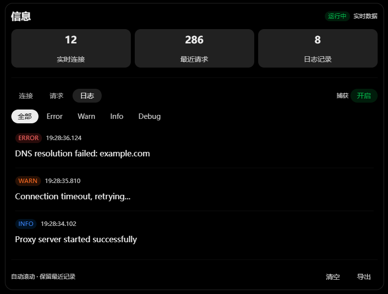

本文档从FLClash视角出发，列出FLoway缺失能力

## 仪表盘
- IP检查与显示能力，处于开关按卡片的内，包含IP、住宅（或商业，也是一种质量标识）、质量、组织
- 仪表盘组件编辑，许多其它功能。如内存信息、服务状态、连接数/请求数/DNS查询数、内网IP与局域网代理开关。
## 代理（也就是Floway的“节点”）
- 分类应当直接搜索框+策略组切换栏，FLoway当前mock在显示所有订阅
## 配置（也就是FLoway的订阅）
- 缺少编辑与配置文件源码查看
- 添加配置缺少二维码
- 手动创建（也就是FLClash的自定义）区别较大
## 工具（也就是FLoway的设置）
缺太多东西，建议大幅复用，但不要破坏FLoway舒适的设置页面布局
## 侧边栏/底栏
建议新增一个 信息 页面，包含FLClash的实时连接、最近请求、日志；这些信息若有捕获开关、等级也在此页面。我推荐的布局如图：